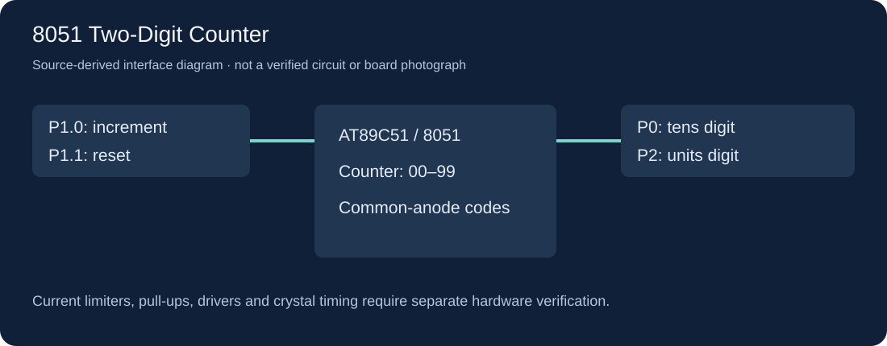

# 8051 Two-Digit Counter

一个用8051单片机练习按键输入和数码管输出的小工程：按住增加键时，计数在00–99间循环；按下清零键后回到00。十位与个位分别由P0、P2输出段码，便于对照C程序理解端口与显示的关系。



> 图为源码接口示意，不是实板照片，也不是经过验证的接线图。

## 状态

**课堂工程 / 软件归档可构建，硬件待验证。** 本仓库保留原有C代码和两份Proteus设计源文件；本次整理不改算法、不运行EDA软件、不烧录或操作实板。实际验证结果见 [VALIDATION.md](VALIDATION.md)。

## 功能与接口

| 项目 | 源码定义 |
|---|---|
| 增加键 | P1.0，低电平按下；包含软件延时去抖和按住连发 |
| 清零键 | P1.1，低电平按下；等待按键释放 |
| 十位段码 | P0 |
| 个位段码 | P2 |
| 段码表 | 共阳0–9，低电平点亮 |

程序使用阻塞延时与等待释放，不是实时多任务框架。目标工程登记24MHz，而源码延时注释按12MHz估算；两者尚未实测校准，不能把注释中的毫秒当作保证时序。P0的电气行为、上拉、限流、驱动和实际数码管公共端必须按原理图及器件核对。

## 技术栈与前置条件

- C51 / 8051，目标工程为AT89C51。
- Keil C51工具链（本仓库不附带商业编译器、头文件、运行库或厂商STARTUP模板）。
- Windows PowerShell 5.1+ 或 PowerShell 7，用于构建脚本。
- Proteus可选，用于打开 `.pdsprj` 设计源；工程能打开不等于仿真已通过。

## 快速上手

```powershell
git clone https://github.com/yangwei251003/8051-two-digit-counter.git
cd 8051-two-digit-counter
./scripts/build.ps1 -KeilRoot 'C:\Keil_v5'
```

如果Keil安装在其他位置，把参数改为自己的安装根目录。脚本只在自建临时目录中编译、汇编和链接，把结果复制到被忽略的 `.runtime/build/`，不会更改源项目或连接单片机。

构建成功后得到 `.runtime/build/counter.hex`。脚本会从你自己的Keil安装读取厂商STARTUP模板，只放到本机被忽略的构建目录；该模板不受本项目MIT许可覆盖。

## 使用Keil或Proteus

- 构建一次后，可用Keil打开 `project/counter.uvproj`；项目使用仓库内相对路径，STARTUP指向本机生成的构建目录。
- Proteus设计源在 `simulation/`。打开后需要核对AT89C51的Program File，将其指向本机刚生成的HEX，并核对晶振、按键和显示连接。
- 当前未对这两份Proteus工程进行GUI仿真、逐针连接审查或实板测量；不要把它们当成制造放行文件。

## 目录结构

```text
src/main.c                 原有8051计数代码
project/counter.uvproj     可移植的Keil项目配置
simulation/                原有Proteus工程设计源
scripts/build.ps1          隔离编译/链接/HEX导出
docs/                      源码接口示意
THIRD_PARTY_NOTICES.md      Keil与Proteus依赖边界
```

同一原文件夹中的Arduino温湿度站骨架是另一个**开发中**项目，没有被混进本仓库，也没有宣称已完成。

## 更新与许可

见 [CHANGELOG.md](CHANGELOG.md)。自有代码、文档与设计内容采用 [MIT](LICENSE)，第三方工具和模板仍适用原许可，见 [THIRD_PARTY_NOTICES.md](THIRD_PARTY_NOTICES.md)。
